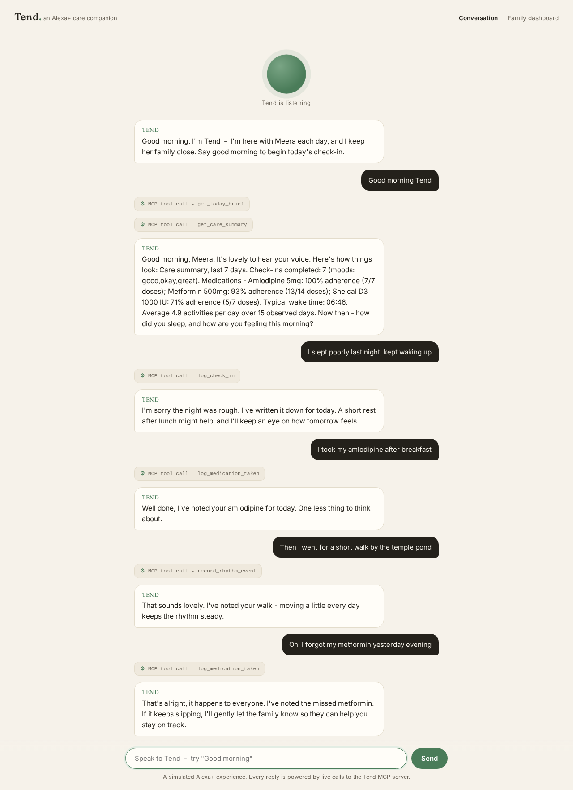
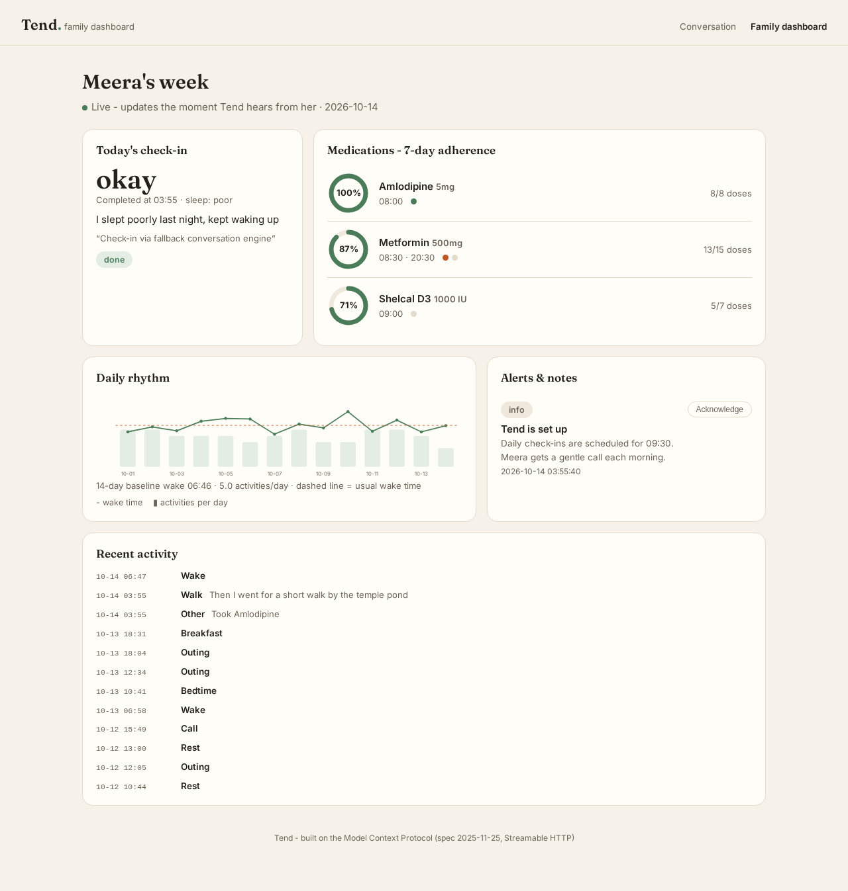

# Tend

**A care companion for aging parents, built as an Alexa+ MCP experience.**

For families living apart from an aging parent, the hard part is often the quiet daily uncertainty. Did she take her tablets? Did he sleep? Is today a normal Tuesday, or the start of something?

Tend is a simulated Alexa+ care experience backed by a working self-hosted MCP server. The current web demo uses typed conversations, records check-ins and medication reports, compares recorded routines, and updates a family dashboard. It does not enroll with Alexa+, place calls, send push notifications, or automatically start check-ins.

> Built for the **Build, Ship, Shape: Amazon Developer Hackathon** (Alexa+ track).
> The MCP server implements **MCP spec 2025-11-25** over **Streamable HTTP**.

## Demo

**Video:** [Tend - an Alexa+ care companion (2:53)](https://www.youtube.com/watch?v=I1KtKPeKMrQ)

| Conversation (simulated Alexa+) | Family dashboard |
| --- | --- |
|  |  |

## The experience

**For the parent** - a typed conversation in the simulated experience:

- "Good morning" starts a warm check-in: how did you sleep, how are you feeling.
- "I took my morning tablets" logs the dose.
- A medication report identifies a specific scheduled dose. Multiple daily doses or past doses require an exact date/time through the MCP tool; the offline conversation refuses to guess.
- "I went for a walk by the temple pond" becomes part of her daily rhythm.
- "I'm feeling a bit low today" completes the check-in and gently lets the family know a call would mean a lot.

**For the family** - a live dashboard that answers "how is she, really?" in one glance:

- Today's check-in status and mood.
- Reported doses taken / tracked scheduled doses due, with unreported doses shown as unknown, not inferred missed.
- A daily-rhythm chart: wake times against her personal 14-day baseline, activities per day.
- Dashboard alerts when an input triggers rule evaluation: repeated low moods, missed doses, a wake time far past her usual.

**Under the hood** - care actions in the conversation are backed by live calls to the Tend MCP server. The web experience is the hackathon's sanctioned *simulated Alexa+ experience*: it shows exactly what Alexa+ can do once connected to an MCP server like this one.

## Architecture

```
            voice (Alexa+ / simulated experience)
                        │
              conversation agent loop
                        │  MCP client
              ┌─────────┴──────────┐
              │   tend-mcp server  │   MCP spec 2025-11-25, Streamable HTTP
              │                    │
              │  10 tools:         │
              │  check-ins, meds,  │
              │  rhythm, alerts,   │
              │  care summaries    │
              └─────────┬──────────┘
                        │
              SQLite + rule-based care logic
              (baseline + anomaly detection a family can read and trust)
                        │
              live family dashboard (SSE)
```

Anomaly detection is deliberately rule-based, not ML: a 14-day baseline of wake times and activity counts, with plain-language rules (woke >90 minutes late, two low check-ins in three days, two missed doses in a day). Families deserve alerts they can understand.

### MCP tools

| Tool | What it does |
| --- | --- |
| `get_today_brief` | Everything due today: check-in, doses, open alerts |
| `schedule_check_in` | Set or move the daily voice check-in |
| `log_check_in` | Record mood, sleep, notes; evaluates wellbeing signals |
| `add_medication` | Register a medication with dose times |
| `log_medication_taken` | Log a dose as taken / missed / skipped |
| `get_adherence` | Per-medication adherence over N days |
| `record_rhythm_event` | Log everyday activities that build the baseline |
| `get_rhythm_summary` | Baseline vs recent days, deviations flagged |
| `notify_family` | Post info / attention / urgent notes to the dashboard |
| `get_care_summary` | A spoken-friendly weekly digest |

## Quickstart

Requires Node.js 22+.

```bash
npm install
npm run seed     # demo persona: Meera, 74, with 14 days of history
npm run mcp      # MCP server on http://127.0.0.1:7701/mcp
npm run web      # simulated experience on http://127.0.0.1:7702
npm test         # isolated assertion-based regression suite
# Run smoke only against a separate seeded demo DB; it mutates demo records.
npm run smoke    # assertion-based MCP transport check of all ten tools
```

Open `http://127.0.0.1:7702` for the conversation and `http://127.0.0.1:7702/dashboard.html` for the family dashboard.

### Connect a real LLM (optional)

The conversation layer runs on any OpenAI-compatible chat-completions endpoint:

```bash
export TEND_LLM_BASE_URL=https://your-endpoint/v1
export TEND_LLM_API_KEY=...
export TEND_LLM_MODEL=...
```

With no LLM configured, a built-in deterministic conversation engine drives the same MCP tools, so the demo always runs offline. Either way, care actions use live MCP calls; clarification replies may make no tool call.

### Connect your own MCP client

Any client that speaks MCP spec 2025-11-25 over Streamable HTTP can connect to `http://127.0.0.1:7701/mcp` and use all ten tools directly.

## Repo layout

```
server/    MCP server: db, care logic, tools, Streamable HTTP entrypoint
web/       conversation experience + family dashboard (Express + SSE)
scripts/   smoke test, demo helpers
docs/      friction log, product feedback, design notes
data/      local SQLite (gitignored; created by npm run seed)
```

## Demo

- Video: the submitted video shows the original prototype; dose behavior is now defined by the tests and code, not that older recording.
- Track: Alexa+ (self-hosted MCP server, spec 2025-11-25, Streamable HTTP)

## License

MIT

## Dose records and coverage

Each new report identifies one medication and local scheduled dose slot. Repeating the same slot/status is idempotent. A conflicting status is refused, not silently changed. Multiple matches, future doses and unknown schedule history are refused. Schedule changes apply from their recorded effective time; dates before registration are unknown. The host's local timezone is used, not a patient-specific timezone.

The percentage is **reported taken / tracked scheduled doses due**, across the requested calendar days through now. Unreported is not a diagnosis or proof of a missed dose. Before recorded schedule history, coverage is unknown. Existing free-form logs are preserved as legacy/unmapped records, excluded from the new numerator and counted separately. Demo seed history is explicitly synthetic.

Automatic anomaly alerts are deduplicated per signal per local day, including after acknowledgement. They are dashboard notes, not emergency dispatch or medical advice. No real-family pilot, clinical validation, authentication or remote-production security claim is made. Use synthetic local data only; the server is a prototype, not a care service.
